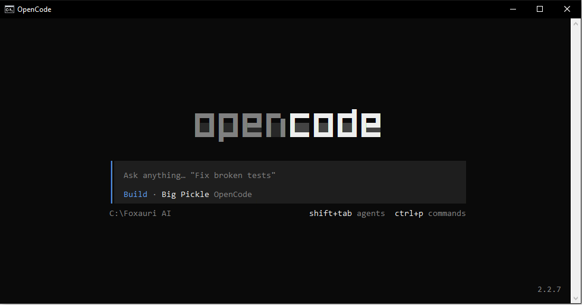

# OpenCode for Older CPUs — Windows x64

OpenCode **v2.2.7** packaged to run on Windows computers where the standard version won't start.

If you see this error, this is the fix:

```
this CPU is missing SSE4.2 support, which Bun requires
```

**No installation needed.** Download, extract, and run. You don't need Node.js or anything else.

> Unofficial build. Not affiliated with the OpenCode project.

[](https://foxauraai.com)

---



---

## Who is this for?

Use this if the normal OpenCode for Windows closes immediately with the SSE4.2 error above. That happens on older processors. This build works differently, so that check never runs.

If the normal version already works for you, you don't need this one.

---

## What you need

- Windows 10 or 11 (64-bit)
- About 200 MB of free space

---

## How to use

### 0. Remove any old version and cache first

Skip this if you've never installed OpenCode before. Otherwise, remove the old files so they don't conflict with this build.

Open **Command Prompt** and run whichever of these apply:

```bat
:: an old OpenCode folder you extracted earlier (change the path to yours)
rmdir /s /q C:\opencode

:: a copy installed through npm
npm uninstall -g opencode-ai

:: cached files from a previous install
rmdir /s /q "%USERPROFILE%\.cache\opencode"
```

If a command says the folder or package can't be found, that's fine. It just means there's nothing to remove.

**Want a completely fresh start?** Also remove your saved login, settings, and session history. This signs you out and deletes your past sessions, so skip it if you want to keep them:

```bat
rmdir /s /q "%USERPROFILE%\.local\share\opencode"
rmdir /s /q "%USERPROFILE%\.config\opencode"
```

### 1. Download

Go to the **Releases** page of this repository and download the latest zip file.

### 2. Extract

Right-click the zip and choose **Extract All**. Put it somewhere simple, for example `C:\opencode`.

> If Windows blocks the files, right-click the zip first → **Properties** → tick **Unblock** → OK, then extract.

### 3. Run

Open **Command Prompt**, then:

```bat
cd /d C:\opencode\cli-node-windows-x64
OpenCode.bat
```

That's it.

Open Command Prompt first instead of double-clicking `OpenCode.bat`. If something goes wrong, the window stays open and you can read the message.

---

## Using it on your own project

```bat
OpenCode.bat "C:\path\to\project"
```

### Shortcut: run it from anywhere (optional)

Add the folder to your `PATH` so you can type just `OpenCode.bat`:

1. Press the **Windows** key, type `environment variables`, and open **Edit the system environment variables**.
2. Click **Environment Variables…**.
3. Under **User variables**, select **Path** → **Edit** → **New**.
4. Paste `C:\opencode\cli-node-windows-x64` and click **OK** on every window.
5. Close Command Prompt and open a **new** one.

Now this works from any folder:

```bat
cd /d D:\my-project
OpenCode.bat
```

---

## What's in the folder

```
cli-node-windows-x64/
├─ OpenCode.bat              <- run this
├─ package.json
└─ bin/
   ├─ opencode2-node.exe     <- the app
   └─ photon_rs_bg.wasm      <- needed by the app
```

Keep everything inside `bin\` where it is. Don't move or delete those two files.

---

## Problems?

| What you see | What to do |
|---|---|
| `this CPU is missing SSE4.2 support, which Bun requires` | You're running the standard version. Use this build instead |
| `'OpenCode.bat' is not recognized` | Make sure you ran `cd` into the folder that contains `OpenCode.bat`, or use the full path |
| The window closes instantly | Start it from an open Command Prompt, not by double-clicking |
| Antivirus deletes or blocks `opencode2-node.exe` | This is a large unsigned program, so some antivirus tools flag it by mistake. Restore the file and add the folder to your antivirus exclusions |
| Errors mentioning `photon_rs_bg.wasm` | Check that this file is still inside `bin\` next to `opencode2-node.exe` |

Still stuck? Open an **Issue** on this repository and include:

- Your CPU model (Task Manager → Performance → CPU)
- Your Windows version
- The full error text

---

## Good to know

- This build removes the Bun CPU requirement. Windows and your CPU still need to meet the basic requirements for running modern 64-bit Windows programs, and it has not been tested on every older processor.
- Updates are published on the **Releases** page.
